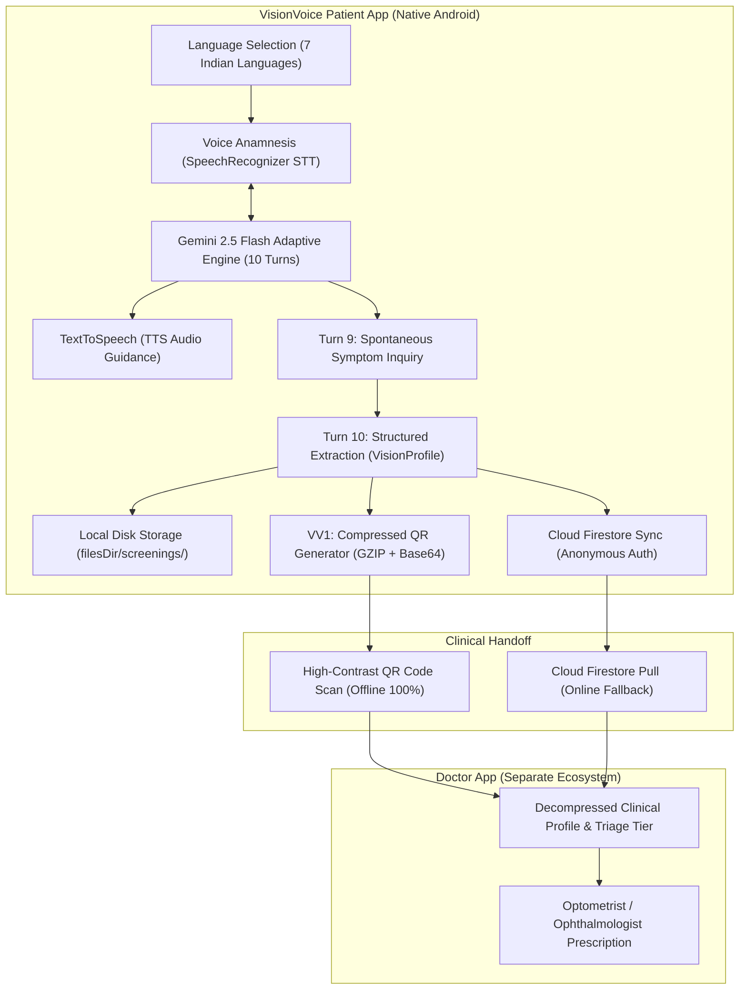

# VisionVoice Patient (VisionVoicePatient) 👁️🎙️
> **No-Device Vision Intelligence:** Voice-first pre-clinical ophthalmic screening powered by on-device multilingual STT/TTS, Google Gemini AI, and dual offline/cloud clinic handoff.

---

## 🌟 Overview & Problem Statement

In rural areas, optical shops and community vision camps frequently lack advanced ophthalmic diagnostic equipment (such as slit lamps, autorefractors, or OCTs) and qualified optometrists. In practice, visual assessments default almost exclusively to basic Snellen letter charts ("A-B-C-D"). 

This diagnostic gap results in two severe consequences:
1. **Missed Pathologies:** Underlying sight-threatening diseases (such as progressive cataracts, diabetic retinopathy, or glaucoma) remain undetected until irreversible damage occurs.
2. **Inappropriate Lens Prescriptions:** Prescriptions are dispensed without understanding the patient's occupational demands (e.g., fine near vision for tailors vs. distance vision for agricultural workers), leading to chronic eye strain, headaches, and abandoned spectacles.

**VisionVoice Patient** bridges this gap using standard Android smartphones. Acting as an empathetic, native-language clinical anamnesis agent, it conducts a 10-turn voice-first pre-screening interview, structures the findings into a PII-safe pre-clinical profile, and transfers it to the registered **Doctor App** via a compressed, high-contrast QR code or Cloud Firestore.

> [!IMPORTANT]
> **Strict Non-Diagnostic Role:** The AI agent **does not diagnose or prescribe**. Instead, it captures, organizes, and classifies clinical and occupational context into a structured pre-clinical report so that licensed ophthalmologists and optometrists can make accurate clinical decisions.

---

## 🏛️ System Architecture



---

## 🚀 Key Features

### 1. Zero-Cost, On-Device Native Voice Engine
- **Multilingual Speech-to-Text (STT):** Powered by Android's native `SpeechRecognizer`, eliminating external audio cloud API costs.
- **Natural Text-to-Speech (TTS):** Uses Android's native `TextToSpeech` engine with dynamic locale switching and automatic audio playback for low-vision or illiterate patients.
- **7 Major Indian Languages Supported:**
  - 🇮🇳 **Hindi** (`hi-IN`)
  - 🇮🇳 **English (India)** (`en-IN`)
  - 🇮🇳 **Bengali** (`bn-IN`)
  - 🇮🇳 **Telugu** (`te-IN`)
  - 🇮🇳 **Tamil** (`ta-IN`)
  - 🇮🇳 **Marathi** (`mr-IN`)
  - 🇮🇳 **Rajasthani** (`raj-IN` with seamless `hi-IN` fallback)

### 2. Adaptive Gemini Clinical Anamnesis (10-Turn Pacing)
- **Empathetic Pacing:** Calibrated strictly to 10 conversational turns ($\le 30$ words per spoken turn to prevent cognitive/auditory fatigue).
- **Core 6 Clinical Dimensions Captured:**
  1. **Occupational Visual Demands:** Primary working distance (tailoring, embroidery, driving, farming).
  2. **Environmental Hazards:** Exposure to biomass cooking smoke, UV sunlight, dust, chemicals.
  3. **Digital Strain & Lighting Conditions:** Screen exposure hours and ambient illumination.
  4. **Refractive Symptoms:** Squinting, frontal headaches, reading blur, distance halos.
  5. **Systemic Medical History:** Type 2 Diabetes, Hypertension, and chronic systemic conditions.
  6. **Pathology Indicators:** Cloudy lens opacity, ocular pain, redness, floaters, flashing lights.
- **Turn 9 Safety Net (`additionalInformation`):** Open-ended clinical inquiry capturing idiosyncratic patient context (e.g., prior agricultural eye trauma or evening grittiness).
- **Turn 10 Structured Synthesis:** Generates a standardized clinical JSON profile with urgency tiering (`ROUTINE`, `PRIORITY`, `URGENT`).

### 3. Functional Vision Classification
Categorizes the patient's dominant daily visual priority:
- `NEAR_DOMINANT`: Prioritizes 30–45 cm clarity (tailors, weavers, jewelers).
- `INTERMEDIATE_DOMINANT`: Prioritizes 60–100 cm clarity (desk workers, counter retail, cooks).
- `DISTANCE_DOMINANT`: Prioritizes > 200 cm clarity (drivers, agricultural laborers).
- `BALANCED_MULTIFOCAL`: Varied focal demands throughout the day.

### 4. Dual Handoff Protocol (100% Offline-First)
- **`VV1:` High-Density Compressed QR Code:**
  - Employs `QrPayloadCompressor` utilizing GZIP + URL-safe Base64 under the `VV1:` protocol header.
  - Shrinks the raw JSON payload by **~70%** (from ~700 bytes down to ~220 bytes), ensuring instant scanning on low-end cameras in dimly lit rural clinics without internet.
  - Includes a 6-character human-readable backup code (`VV-XXXX`).
- **Cloud Firestore Synchronization:**
  - Asynchronously syncs profiles to Cloud Firestore collection `screening_profiles/{id}` using silent Firebase Anonymous Authentication (`signInAnonymously()`).
  - Completely preserves patient privacy (no PII, phone numbers, or passwords collected).

---

## 🛠️ Tech Stack & Architecture

- **Language:** Kotlin (100% Native)
- **UI Toolkit:** Jetpack Compose (Material 3 with WCAG AAA "Clinical Clarity" high-contrast theme)
- **Architecture:** Clean Architecture + MVVM + Kotlin StateFlow
- **AI Engine:** Google AI Client SDK for Android (`com.google.ai.client.generativeai:generativeai`)
- **Speech Engine:** Android Native `SpeechRecognizer` & `TextToSpeech`
- **QR Generation:** ZXing Core (`com.google.zxing:core`)
- **Data Persistence:** Kotlinx Serialization + Local Sandbox Storage (`filesDir/screenings/`)
- **Cloud Backend:** Firebase Android BOM (Anonymous Auth + Cloud Firestore)

---

## 📂 Project Structure

```
VisionVoicePatient/
├── app/
│   ├── src/main/java/com/visionvoice/patient/
│   │   ├── ai/
│   │   │   └── GeminiAnamnesisService.kt     # 10-turn pacing & structured extraction
│   │   ├── data/
│   │   │   ├── model/
│   │   │   │   └── VisionProfile.kt          # Clinical data models & handoff payload
│   │   │   └── repository/
│   │   │       └── ScreeningRepository.kt    # Offline-first storage & Firestore sync
│   │   ├── ui/
│   │   │   ├── components/
│   │   │   │   └── VoiceComponents.kt        # VoiceOrbVisualizer, playback cards, buttons
│   │   │   ├── screens/
│   │   │   │   ├── LanguageSelectionScreen.kt# 7 Indian languages selection
│   │   │   │   ├── VoiceAnamnesisScreen.kt   # Live voice UI, orb ripple, transcript
│   │   │   │   ├── PreClinicalSummaryScreen.kt # Triage review, dominance, dimensions
│   │   │   │   └── QrHandoffScreen.kt        # High-contrast QR, backup code & sync badge
│   │   │   ├── theme/                        # Material 3 Clinical Clarity color tokens
│   │   │   └── viewmodel/
│   │   │       └── ScreeningViewModel.kt     # Central state & voice lifecycle coordinator
│   │   ├── util/
│   │   │   ├── QrCodeGenerator.kt            # ZXing QR Bitmap generator
│   │   │   └── QrPayloadCompressor.kt        # GZIP + Base64 compression (VV1: protocol)
│   │   ├── voice/
│   │   │   └── VoiceManager.kt               # SpeechRecognizer STT & TextToSpeech TTS
│   │   └── MainActivity.kt                   # Edge-to-edge Compose navigation
│   └── src/test/java/com/visionvoice/patient/
│       └── Phase3VerificationTest.kt         # Compression round-trip & profile unit tests
```

---

## ⚙️ Setup & Installation

### Prerequisites
- Android Studio Ladybug / Meerkat (or newer)
- Android SDK 35+ (Min SDK 26, Target SDK 37)
- Java 17 / 21
- A physical Android device or emulator with a microphone enabled

### 1. Clone the Repository
```bash
git clone https://github.com/your-username/VisionVoicePatient.git
cd VisionVoicePatient
```

### 2. Configure Gemini API Key
Obtain a free API key from [Google AI Studio](https://aistudio.google.com/). Add it to your local `local.properties` file in the root directory:
```properties
gemini.api.key=YOUR_GEMINI_API_KEY_HERE
```
*(Note: If no API key is supplied, the app automatically runs in resilient offline mode using clinical heuristic fallback questions and rule-based extraction).*

### 3. Configure Firebase (Optional for Cloud Sync)
1. Create a project in the [Firebase Console](https://console.firebase.google.com/).
2. Add an Android app with package name `com.visionvoice.patient`.
3. Enable **Anonymous Authentication** under **Authentication** $\rightarrow$ **Sign-in method**.
4. Create a **Cloud Firestore** database (in test mode for development).
5. Download your `google-services.json` and place it at:
   ```
   app/google-services.json
   ```
*(A template is provided at `app/google-services.json.example`).*

### 4. Build and Run
```bash
./gradlew assembleDebug
```
Deploy the APK to your connected Android phone or emulator via Android Studio.

---

## 🧪 Testing

Execute automated unit tests covering payload compression and data integrity:
```bash
./gradlew testDebugUnitTest
```

---

## 🔒 Privacy & Safety

- **Zero PII (Personally Identifiable Information):** No patient names, telephone numbers, emails, addresses, or photos are ever collected or stored.
- **Ephemeral Identifiers:** Each screening session generates an ephemeral UUID and a 6-character clinic verification code (`VV-XXXX`).
- **Encrypted Local Storage:** Profiles are written exclusively to the app's internal sandbox storage (`context.filesDir`).

---

## 📄 License
This project is licensed under the [MIT License](LICENSE).
